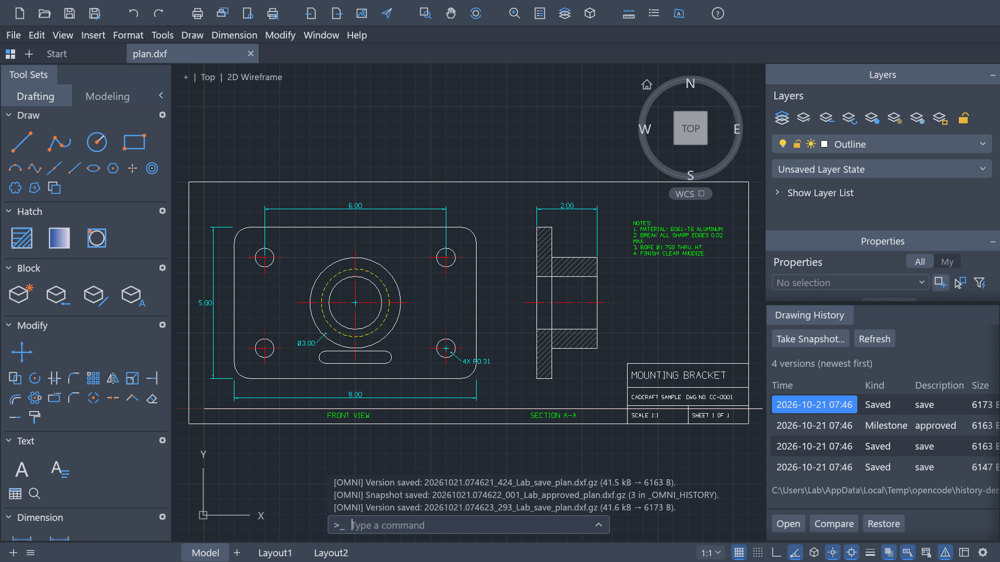

# Drawing history (the OMNI toolkit)

CADCraft keeps a *drawing history* next to the drawing it belongs to: a version of the drawing for
every save that changes it, named milestones when you want them, a palette that lists them, and a way
to lay an old revision under the current one or put it back. It comes from a small AutoLISP toolkit
(`OMNI.lsp`) its author used inside AutoCAD, and is here rebuilt as native commands — no AutoLISP, no
`-XREF`/`-LAYER` command-line scripting, and working the same for DXF and DWG.

Everything is a command, so the command line, the menus (**Tools ▸ Drawing History** and
**Window ▸ Drawing History**), the palette, scripts, the CLI, the control channel and MCP all reach
the same code. See [control-protocol.md](control-protocol.md) for the JSON forms.



## Two kinds of version

- **A save that changes the drawing leaves one behind**, without being asked. `SAVE`, `QSAVE` and
  `SAVEAS` write a version when the drawing differs from what its file held — the unsaved-changes
  flag is the test — so the history is a timeline of the saves you already make. Those are filed
  under the description `save`. A save of an unchanged drawing adds nothing, and neither does a save
  after an edit and its undo: the drawing comes back to what the newest version already holds.
- **`OMNI-SNAP` takes a named milestone** of the drawing as it is right now — unsaved changes
  included, the file on disk untouched — for a state you want to name and come back to.

Versions are gzipped on disk: a DXF is verbose text and shrinks several times over (about seven on
the sample plan), so a long history costs what a folder of plain copies would cost only after that
many more saves. A plain `.dxf`/`.dwg` written by an older build is still listed, compared and
restored.

## The palette

**Window ▸ Drawing History**, `OMNI-LOG` (or `VERSIONS`, or `HISTORY`) typed at the command line, or
**Tools ▸ Drawing History ▸ Snapshot History…** opens the palette, docked with the other palettes.
It lists the versions newest first — time, kind (`Saved` or `Milestone`), description, size — marks
unsaved changes since the last save, and for the selected version offers:

- **Open** — the revision as a drawing of its own, in a tab beside the current one. A version is the
  history's, not a drawing to edit in place: saving onto it is refused, so **Save As…** gives the
  revision a file name (and a history) of its own.
- **Compare** — `OMNI-DIFF`: the revision laid under the drawing in red, plus what changed.
- **Restore** — the revision put back into the drawing as an unsaved change. The drawing's own file
  is untouched, `UNDO` goes back, and the next save writes it and leaves a version of its own.
- **Take Snapshot…** — `OMNI-SNAP`, for a milestone of the state as it is now.

The palette is a thin view: it lists through `omni-versions` and acts through the same commands as
the command line, so anything it does can be scripted, and it never echoes to the command line.

## Commands

| Command | Aliases | What it does |
|---|---|---|
| `OMNI-SNAP` | `OMNISNAP` | Writes a named milestone of the drawing as it is right now, into `_OMNI_HISTORY` next to it |
| `OMNI-LOG` | `OMNILOG`, `OMNI`, `VERSIONS`, `HISTORY` | Lists the versions newest first (number, time, size, description, file) and opens one; typed or from a menu it opens the palette |
| `OMNI-VERSIONS` | | The palette's listing as JSON, without the command-line echo |
| `OMNI-DIFF` | `OMNIDIFF` | Lays a version under the drawing as a recoloured overlay reference, and/or reports what changed |
| `OMNI-RESTORE` | | Puts a version back into the drawing, undoably |
| `OMNI-TOGGLE` | `OMNITOGGLE` | Shows or hides the version overlay |
| `OMNI-CLEAR` | `OMNICLEAR` | Detaches the overlays `OMNI-DIFF` attached — and nothing else |
| `OMNI-NOTE` | `OMNINOTE` | A marker circle and a comment on the `OMNI_NOTES` layer |

Typed at the command line, `OMNI-SNAP` asks for the description, `OMNI-DIFF` lists the history and
asks for a number (`0` cancels), and `OMNI-NOTE` asks for the point and then the comment,
rubber-banding the marker as you move.

```text
Command: QSAVE
[OMNI] Version saved: 20261014.083512_482_lab_save_plan.dxf.gz (21.4 kB → 2.3 kB).

Command: OMNI-DIFF
[OMNI] Snapshot history (3 in C:\jobs\site\_OMNI_HISTORY):
[  1] 2026-10-14T08:35:12.482Z    2.3 kB  save         20261014.083512_482_lab_save_plan.dxf.gz
...
Enter the number of the snapshot to compare with <1>: 1
[OMNI] OMNI_plan_20261014_083512: 214 object(s) on 6 layer(s) laid under the drawing in ACI 1. Hide it with OMNI-TOGGLE, detach it with OMNI-CLEAR.
```

## Versions on disk

A version is a **complete copy of the drawing**, written through the same writer a save uses, so it
is a DXF when the drawing is a DXF and a DWG when it is a DWG, and then gzipped. A milestone is
taken from the drawing as it stands, *including changes that are not saved yet* — nothing is
written back to the drawing's own file, which is why `OMNI-SNAP` is not a save and cannot lose
unsaved work.

Versions live in `_OMNI_HISTORY` in the drawing's folder, named:

```text
<date>.<time>_<milliseconds>_<user>_<description>_<file>.<ext>.gz

20261014.083512_482_lab_walls-done_plan.dxf.gz
```

- **Date and time** are UTC, so one history folder stays sortable and comparable however many
  machines and time zones it is written from; a plain name sort is a chronological sort.
- **Milliseconds** keep two versions written in the same second apart.
- **User** comes from `CADCRAFT_USER`, `USER`, `USERNAME` or `LOGNAME` — whichever the platform
  sets — so a version says who made it on Windows, Linux, macOS and FreeBSD alike.
- **Description** is `save` for the ones a save leaves behind, and the milestone's name otherwise.
  It is folded into a file name (letters and digits of any script survive, so a description in
  Russian is fine; separators and path characters become `-`). It is at most 48 characters and
  never contains `_`, which is what makes a name parseable back exactly.
- **File** is the drawing's own name, which is why the drawing is recovered exactly however many
  separators the parts before it had.
- **`.gz`** is the compression suffix; the extension before it says what the drawing inside is.

`OMNI-LOG` reads what a name says without opening the version; a file in the folder that does not
follow the pattern is still listed, with what its name didn't say left empty, and a version stored
plain by an older build is read as it is.

Anything that needs the version *as a file* — the overlay reference, which goes through the io
hooks like any xref — unpacks it once into `_OMNI_HISTORY/.cache`, named after the version. The
cache is inside the history folder, so it travels with it, never goes stale (a version's name never
changes) and can be deleted at any time.

`OMNI-LOG {open}` loads a revision as a drawing of its own. The revision belongs to the history it
came from: the drawing it opens is `_OMNI_HISTORY/…`, so the commands resolve it back to the host
drawing and browsing the timeline carries on in the opened revision instead of offering it a
history inside the history folder. A revision opens under its own file name, so a plain save would
write into the cache: use **Save As…** to keep a copy of an old revision, or `OMNI-RESTORE` to put
it back into the drawing you are working on.

## Seeing what changed

`OMNI-DIFF` (the default, `mode: "overlay"`) attaches the version as an **overlay reference** at
0,0 — aligned with the drawing, because both are the same drawing — and recolours everything it
brings to a single colour (ACI 1, red, or `color:` any ACI 1–255). Both its layers *and* its
objects: the AutoLISP original recoloured only the layers, and an object carrying a colour of its
own would stay visible in it.

- `OMNI-TOGGLE` shows and hides the overlay by unloading and reloading its reference — the
  reference stays attached either way. The AutoLISP original turned the overlay's *layers* off,
  which leaves behind every object the snapshot kept on layer 0, and an external reference's layer
  0 is the *host's* layer 0 (in AutoCAD as here), so those objects can't be hidden that way. The
  colour the overlay was given stays on its layers, so showing it again brings it back red.
- `OMNI-CLEAR` detaches the overlays and nothing else: an external reference of the user's own
  stays attached, wherever the history folder is and whatever it is called. An overlay is found by
  what its reference reads — a file inside a history folder — not by its name, so `XATTACH` with a
  name like `OMNI_site` is the user's reference and is left alone.

`OMNI-DIFF` with `mode: "report"` attaches nothing and instead compares the drawing with the
version through the same machinery `COMPARE` uses (objects matched by geometry and properties,
handle first) and answers with the counts and the areas holding changes:

```json
{"id":1,"method":"engine.execute","params":{"command":"omni-diff","params":{"mode":"report"}}}
→ {"result":{"counts":{"added":12,"removed":3,"changed":5,"common":4961},"regions":[[[0,0],[120,80]]]}}
```

`mode: "both"` does both in one call. A version that is already attached is reused rather than
attached twice, so calling `OMNI-DIFF` again is safe.

## Going back

`OMNI-RESTORE {snapshot}` (the palette's **Restore**) replaces the drawing with that version as one
undoable change: the drawing's own file is not written and its tab and file name stay, while its
layers, settings and objects become the version's — a restore is the whole document, not a merge
into it. `UNDO` goes back, and the drawing counts as changed, so the next save records the restored
state as a new version and the timeline carries on from there. It refuses to run with the Block
Editor open, and it needs to be told which version — a bare `OMNI-RESTORE` restores nothing rather
than guessing.

## Notes

`OMNI-NOTE` places a circle (radius 50 by default) and the text you type (height 25 by default) on
the `OMNI_NOTES` layer, created red if it doesn't exist yet and left alone if it does — so a
drawing's own note layer keeps its own settings. Both sizes and the layer are parameters, and the
note is one undoable change like any other drawing edit.

## What the port adds over the AutoLISP original

- **Versions without an extra step.** Every save leaves one behind, because that is the history a
  user actually wants; `OMNI-SNAP` is left for the milestones worth a name.
- **DXF as well as DWG.** A version is written and read back through the io layer, so a DXF
  drawing gets a DXF history and an AutoCAD DWG gets a DWG one, and either can be diffed.
- **No file copy on save.** The original ran `QSAVE` and copied the file; a version here is the
  drawing in memory, so it is exact and an unsaved drawing can be versioned too.
- **A tenth of the disk.** Versions are gzipped, and a plain copy from an older build is still read.
- **A report, not only an overlay.** `mode: "report"` answers what changed as data, which is what
  an agent or a script wants; the overlay is for the eye.
- **A toggle that always hides.** Unload and reload rather than layer on/off, so an underlay whose
  objects sit on layer 0 cannot be left behind.
- **Nothing platform-specific.** Paths are built with `std::path`, an overlay reference is stored
  relative to the drawing with `/`, the user name comes from the environment and the stamp is UTC.
- **The same on every surface.** The commands are ordinary commands: command line, menus, palette,
  scripts, `cadcraft-cli`, the control channel and MCP. File-system commands report "not available
  on the web" in the browser build; `OMNI-TOGGLE`, `OMNI-CLEAR` and `OMNI-NOTE` work there too.
