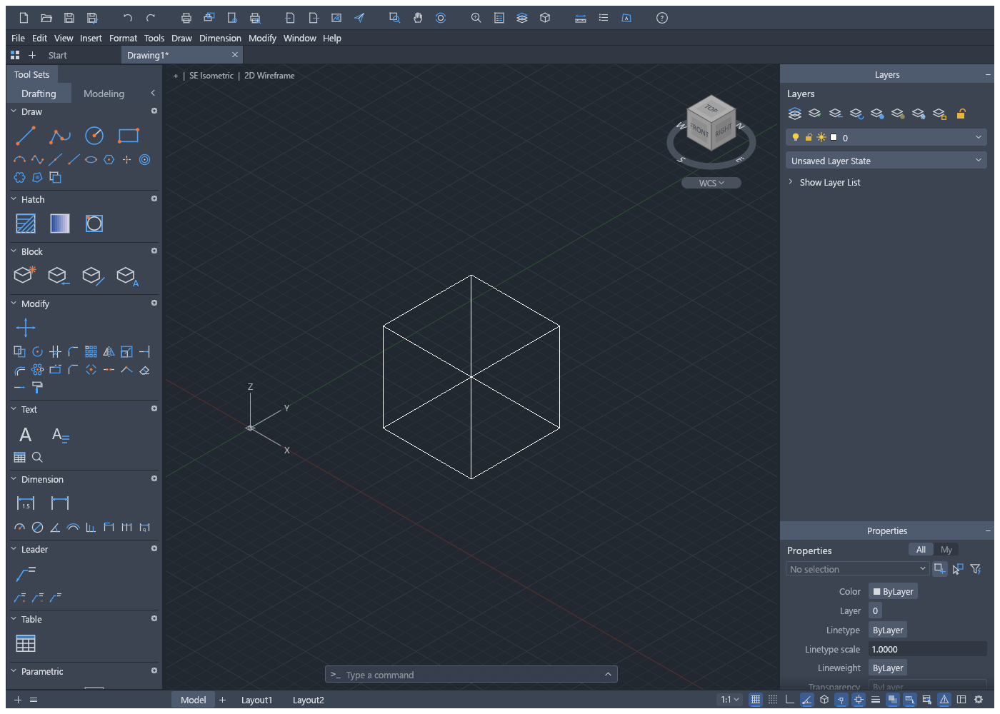
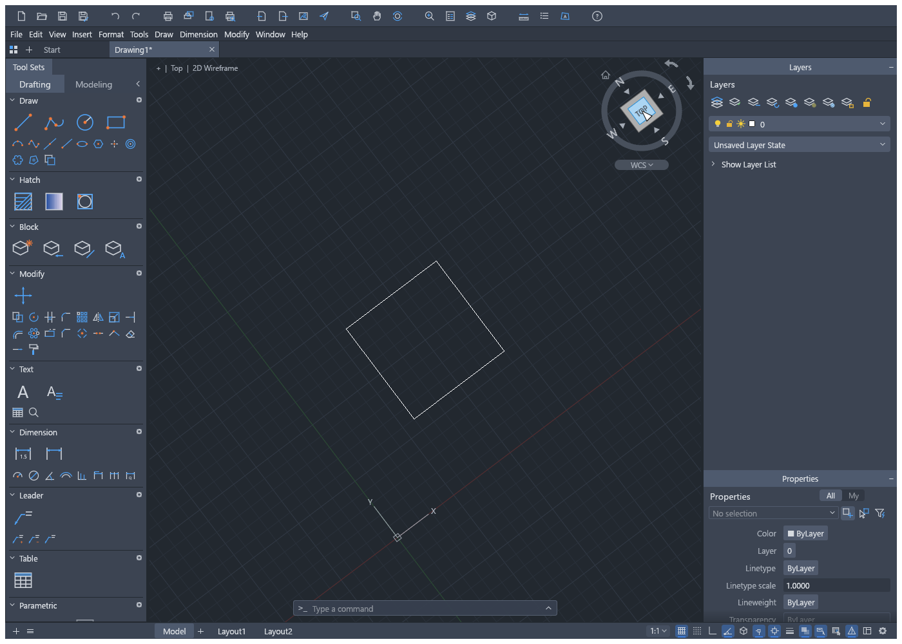
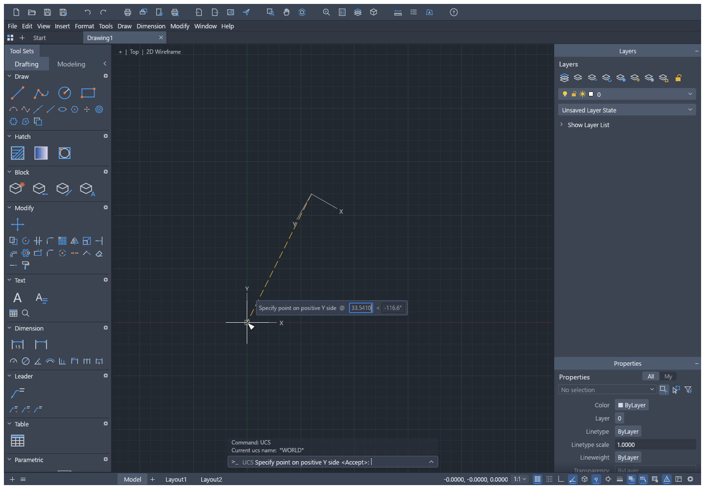

# UCS drafting and view navigation

CADCraft keeps drawing geometry in world coordinates (WCS). The current user coordinate
system (UCS) controls interactive point and direction input, coordinate readouts, drafting
aids and oriented selection. Camera navigation changes the view of that geometry.

## Working coordinates

- `UCS`: Origin/3 Point, World, Previous, Named, Object, View and Z. Previous retains ten
  definitions per space. Model space and each paper-space layout have independent frames.
- Named UCSs can be saved, restored, listed and deleted. Changes participate in undo/redo.
- Typed `x,y`, `#x,y`, `@dx,dy` and polar input use the current UCS. `*x,y`, `*@dx,dy` and
  `@*dx,dy` explicitly use WCS. Commands accepting 3D points retain their typed Z.
- Grid, snap, ortho, polar/object tracking and isometric directions follow the working frame.
  Window/Crossing/Box selection and their previews use the same oriented region. STRETCH
  uses that region for its vertex decisions too.
- Rectangles, text, block placement, clipboard placement, tables, annotations and interactive
  horizontal/vertical constraints use their creation frame. Existing constraints retain
  their saved axes when the current UCS changes.
- Programmatic geometry parameters remain WCS. ID and DIST retain their WCS result fields
  and provide UCS information alongside them. AutoLISP point input and selection use UCS;
  `trans` converts explicitly between coordinate systems.

During UCS point placement, a fixed-size preview follows the proposed origin, X axis and
positive-Y side. The dashed guide is clipped before it is tessellated. The preview does
not edit the drawing; Escape cancels each stage and confirmation creates one undo step.

`UCSICON` controls visibility and origin placement. The icon follows the actual camera and
stored UCS, includes Z in 3D views and falls back to a corner when it would overlap selectable
geometry or leave the canvas. Axis directions parallel to the view collapse naturally.

## Camera navigation

- `VPOINT` accepts a direction or an orthographic/isometric preset. Optional `up: [x,y,z]`
  supplies the world-space screen-up direction. A complete orientation is validated before
  it is applied and fitted. Zero, parallel and invalid vectors are rejected atomically.
- `PLAN` returns to the World top view and fits the drawing.
- `3DORBIT` uses primary-button drags until Enter/Escape. Shift + middle-button drag temporarily
  orbits model space while preserving the running drafting command. Plain middle-button
  drag pans. Navigation consumes ordered input events, including release in the same frame.
- `DVIEW` supports twist, pan, zoom, action Undo and its selected-object/DVIEWBLOCK preview.
  Model view changes use view history; a layout viewport edit uses drawing undo.
- The ViewCube offers 26 UCS-oriented destinations: six faces, twelve edges and eight corners.
  Hovering highlights the actual destination. Face clicks align direction and screen-up without
  redefining the UCS; edge/corner clicks keep the UCS vertical projected upright.
- Hovering an aligned face reveals four adjacent-face arrows and clockwise/counterclockwise
  quarter-turn buttons. Arrows follow the face's roll, preserve that roll on side views and
  retain the departing heading at the poles. Quarter turns keep direction, center and zoom.
  Home appears on hover and fits the drawing. Cube dragging orbits.
- UCS View derives its axes from the active camera, including twist. The compass remains
  WCS-referenced; dragging follows the pointer in Top, Bottom and isometric views.
- Hover/selection highlights, interactive element previews and grips share the displayed
  projection, including after orbit, pan, zoom and twist.
- `VSCURRENT` supports 2D Wireframe, Shaded and Shaded with Edges. Projection is shared by
  the canvas and image/vector exports, including 3D faces and polyface meshes.

Engine `View::twist` and document angles are radians. `view.set`/`view.get` expose twist in
degrees; omitted `view.set.twist` keeps the current value. `DVIEW.twist`, `UCS.angle` and
`3DORBIT.azimuth`/`elevation` are degrees. VPOINT vectors are WCS vectors.

## Files and current limits

DXF/DWG preserve current and named UCS definitions, layout/viewport UCS metadata, view
direction, target and twist. A stored UCS name is restored only while its definition still
matches the saved frame. Older serialized data defaults new angle fields to zero.

Interactive drafting supports planar XY frames, including reversed Y. Tilted UCSs retain their original axes and are visualized, while point input falls back to
WCS with a notification. UCS X/Y/ZAxis/Face, arbitrary tilted-plane drafting, UCSMAN,
automatic UCSVP switching and PLAN Current/Named are not implemented here. Picking and
snaps away from the XY plane in 3D views remain approximate. Perspective and the remaining
DVIEW camera/clip options are unavailable. 3D navigation requires a single model viewport;
use PLAN before splitting model space with VPORTS. Oversized polyface meshes are saved as
3D faces when their counts or vertex indices exceed the DXF 16-bit record fields.

## Public integration references

Reviewed on 2026-10-19. These references identify the selected public foundations; they
do not imply that another author's PR has been merged or superseded.

| PR | Author | Reviewed head | Integrated behavior |
|---|---|---|---|
| [#1533](https://github.com/storytold/cadcraft/pull/1533) | @SBaksa | `be56597e5f24` | UCS commands, input, readouts, AutoLISP and persistence, including review corrections |
| [#1547](https://github.com/storytold/cadcraft/pull/1547) | @SBaksa | `fed42f45b20c` | UCS drafting aids, grid and DIMLINEAR |
| [#1005](https://github.com/storytold/cadcraft/pull/1005) | @Adiakys | `3d278dd6bae7` | 3D camera commands, projection, visual styles and polyface meshes, including review fixes for plot layers/transparency, tiles, ZOOM All and large-mesh export |
| [#1230](https://github.com/storytold/cadcraft/pull/1230) | @mattlafy | `212f6cc98816` | DVIEW, model/tile/viewport twist and view mappings |
| [#1132](https://github.com/storytold/cadcraft/pull/1132) | @marcoarnulfo | `b5d5d7c3dcc6` | Ordered middle-button input and slow-frame regression |
| [#1484](https://github.com/storytold/cadcraft/pull/1484) | @SBaksa | `22de4adc0164` | Viewport UCS and retained settings through save/copy |
| [#1022](https://github.com/storytold/cadcraft/pull/1022) | @leonardopbatista | `48c40fdb4245` | Rendered text bounds for selection and spatial indexing |
| [#1024](https://github.com/storytold/cadcraft/pull/1024) | @leonardopbatista | `29b8a0b8e907` | Geometry-based block crossing selection |

The integration adds command-frame corrections, oriented selection, guarded UCS placement
previews, a camera-projected cube/compass/XYZ icon, complete face orientation and temporary
orbit behavior. Focused engine, UI, projection and file tests cover these combinations.
Previously merged [#1032](https://github.com/storytold/cadcraft/pull/1032),
[#1046](https://github.com/storytold/cadcraft/pull/1046),
[#1275](https://github.com/storytold/cadcraft/pull/1275) and
[#1558](https://github.com/storytold/cadcraft/pull/1558) remain the foundations for selection
preferences, stable highlights, direction properties and the drawn dropdown chevron.
